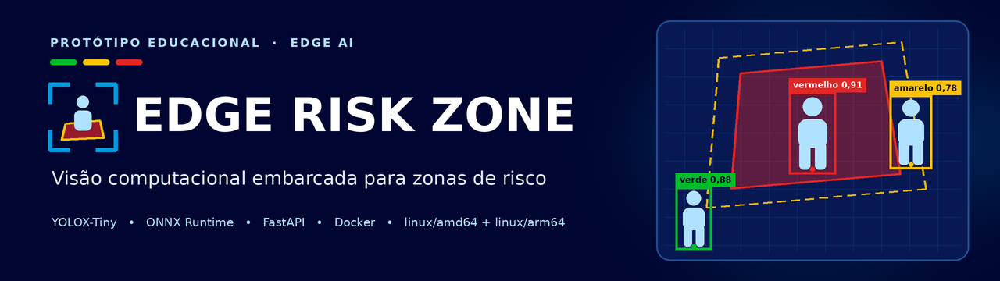
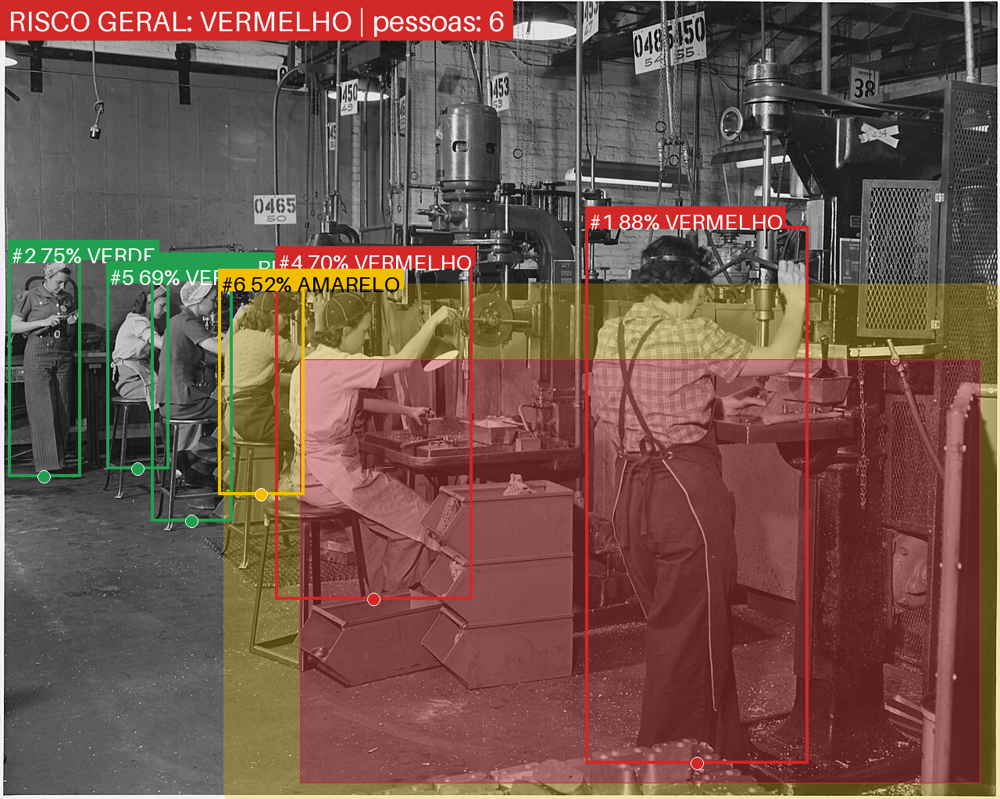
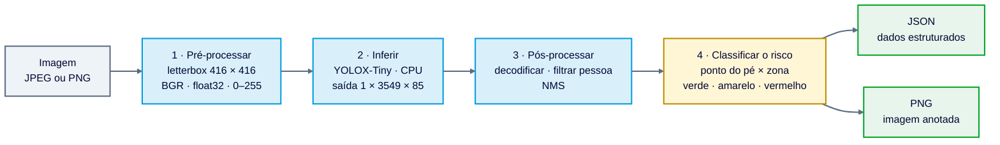
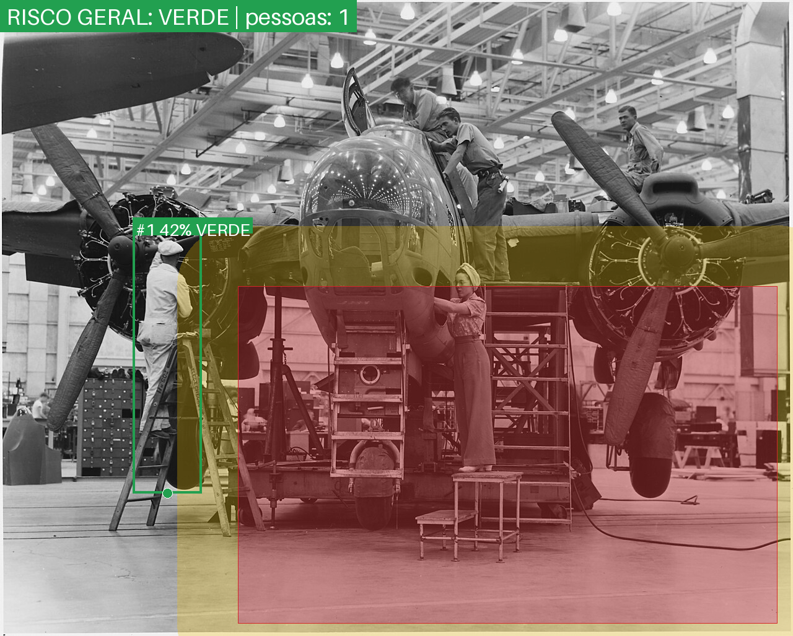

<p align="center">
  
</p>

# Edge Risk Zone

**Detecta pessoas e classifica o risco em relação a uma zona virtual de perigo.**
A inferência é executada exclusivamente em CPU, sem nuvem, em Docker para `linux/amd64` e `linux/arm64`.

- **Entrada:** imagem JPEG/PNG (obrigatória); polígono da zona e limiar (opcionais)
- **Saída:** JSON estruturado ou PNG anotado
- **Stack:** YOLOX-Tiny · ONNX Runtime · FastAPI · Docker
- **Origem:** Projeto ID 3 da matriz Edge AI; alvo: Raspberry Pi 5 (execução na placa ainda não verificada)

> [!IMPORTANT]
> Protótipo educacional de detecção de **presença**. Não interpreta comportamento e **não substitui** barreiras
> físicas, intertravamentos nem sistemas conformes à NR-12 / ISO 13849. Veja [Limitações](#limitações).

**Navegação:** [Executar](#executar-em-dois-minutos) · [Endpoints](#endpoints) · [Como funciona](#como-funciona) · [Docker](#docker-e-multi-arquitetura) · [Raspberry Pi 5](#adaptações-para-a-raspberry-pi-5)

## Executar em dois minutos

Pré-requisitos: Git, Docker com Compose e internet na primeira construção (baixa a imagem-base e as dependências).

1. **Baixe o código:**

   ```bash
   git clone https://github.com/anderson-ferreira-83/edge-risk-zone.git
   cd edge-risk-zone
   ```

2. **Construa e suba a API** (alguns minutos na primeira vez, conforme a internet; depois sobe em segundos):

   ```bash
   docker compose up --build        # sobe a API em http://localhost:8000
   ```

   Se o comando falhar por causa de `platforms:` (Docker sem o armazenamento *containerd*, que não aceita várias plataformas de uma vez), comente essa chave em `docker-compose.yml` e repita. Detalhes em [Execução avançada](#execução-avançada-e-configuração).

3. **Confira que está de pé** (o status deve chegar a `healthy` em `docker compose ps`):

   ```bash
   curl -s http://localhost:8000/health
   ```

4. **Chame os dois endpoints** com as fotos de `samples/` (comandos prontos em [Exemplos](#exemplos)) ou use as páginas abaixo.
5. **Pare:** `docker compose down`.

- Documentação interativa (Swagger): <http://localhost:8000/docs>
- Demonstração visual: <http://localhost:8000/demo>
- Guia dos alunos: <http://localhost:8000/demo/ajuda>
- Mapa dos requisitos e evidências da Parte 1: <http://localhost:8000/demo/pipeline>



### Ambiente testado e sistema operacional

- **Imagens:** sempre Linux (`linux/amd64` e `linux/arm64`). No Windows e no macOS, o Docker executa os containers dentro de uma máquina virtual Linux (WSL2 ou equivalente); não existe imagem Windows.
- **Onde foi validado:** Ubuntu 24.04 em WSL2 (kernel 5.15), Docker Engine 29.8.1, Buildx 0.37.1, CPU x86_64. Não houve execução na Raspberry Pi 5.
- **Comandos deste README:** shell Linux ou macOS (bash). No Windows PowerShell 5.1, `curl` é outro comando: use `curl.exe` e passe a zona por arquivo (`-F "zone=<zona.json"`).
- **Raspberry Pi 5:** use um sistema de 64 bits (por exemplo, Raspberry Pi OS 64 bits); `uname -m` deve mostrar `aarch64`.

## Projeto escolhido: ID 3 da matriz

O teste oferecia cinco projetos. Este é o **ID 3** ("Monitoramento de Comportamento de Risco em Zonas de Máquinas Pesadas"), com escopo ajustado e declarado:

| Situação | Requisitos da matriz |
|---|---|
| **Atendido** | zona poligonal configurável; detecção de pessoas na região; classificação em verde, amarelo e vermelho; várias pessoas na cena; imagem `linux/arm64` |
| **Parcial** | alertas proporcionais (informativos, sem acionamento físico); "tempo real" (uma imagem por requisição) |
| **Adaptado** | "comportamento de risco" vira **presença em uma região** |
| **Não validado** | câmera elevada, fumaça e iluminação noturna; execução e latência na Raspberry Pi 5 |

Frase por frase, com a fonte e o arquivo que sustenta cada linha: [rastreabilidade do ID 3](docs/evidence/project_id3_traceability.md).

## Contexto educacional

Este projeto é a entrega técnica da Parte 1 de um **curso presencial de IA Aplicada**. A demonstração local permite
que a equipe e os alunos experimentem o pipeline sem alterar código: o [guia de uso](http://localhost:8000/demo/ajuda)
propõe a atividade de calibração, enquanto o [mapa da Parte 1](http://localhost:8000/demo/pipeline) liga cada exigência
à implementação e à evidência correspondente. O seletor 50%/75%/100% muda em conjunto apenas a exibição do preview
e do resultado, sem alterar a imagem processada ou os parâmetros enviados ao modelo.

## Execução avançada e configuração

O `build` do Compose lista `linux/amd64` e `linux/arm64`. Em um Docker sem o armazenamento *containerd*, que não aceita várias plataformas de uma vez, comente a chave `platforms:` ou construa só a arquitetura do próprio computador com `docker build -t edge-risk-zone:latest .` e depois rode `docker compose up`. O `scripts/build_multiarch.sh` gera as duas arquiteturas: com o armazenamento *containerd* ele carrega as imagens localmente; sem ele, use `--push` para um registro.

Sem Docker (Python 3.12):

```bash
python -m venv .venv && source .venv/bin/activate
pip install -r requirements-dev.txt
uvicorn app.main:app --port 8000
```

O modelo (`models/yolox_tiny.onnx`, 20 MB) já está no repositório, então **nada é baixado em tempo de execução**.
Para conferir a integridade: `scripts/download_model.sh`.

### Configuração (variáveis de ambiente)

| Variável | Padrão | Função |
|---|---|---|
| `CONF_THRESHOLD` | `0.35` | Confiança mínima para aceitar uma detecção |
| `NMS_IOU` | `0.45` | IoU acima do qual a caixa de menor confiança é suprimida (NMS) |
| `MAX_CONCURRENT_INFERENCES` | `1` | Inferências simultâneas; as demais esperam na fila, em vez de disputar os núcleos |
| `ORT_INTRA_THREADS` | `0` | Threads do ONNX Runtime (0 = padrão; na Pi 5, teste `4`) |
| `ZONE_PATH` | `config/zone.json` | Zona padrão (montada como volume no Compose) |
| `MAX_UPLOAD_MB` | `10` | Tamanho máximo do upload (acima disso: HTTP 413) |

## Endpoints

| Método e rota | Entrada | Saída |
|---|---|---|
| `POST /detect` | `file` (imagem), opcionais `zone` (JSON) e `conf` | **JSON**: pessoas, caixas, confiança, distância à zona, risco, alerta, tempos |
| `POST /detect/image` | iguais | **PNG anotado** com zona, faixa de atenção, caixas, rótulos e risco geral |
| `GET /health` | | Estado do serviço (usado no healthcheck do Docker) |
| `GET /zone` | | Zona padrão carregada |
| `GET /demo` | | Demonstração visual; as páginas de apoio ficam em `/demo/ajuda` e `/demo/pipeline` |

A zona usa **coordenadas normalizadas** (0 a 1), então vale para qualquer resolução de câmera:
`{"polygon": [[x, y], ...], "margin": 0.06}`, em que `margin` é a largura da faixa amarela como fração da diagonal da imagem.

Erros: `400` (arquivo vazio ou que não é imagem), `413` (arquivo grande demais), `422` (zona ou `conf` inválidos).

### Exemplos

```bash
# 1) JSON com as detecções
curl -s -X POST -F "file=@samples/drill_press.jpg" http://localhost:8000/detect

# 2) PNG anotado
curl -s -X POST -F "file=@samples/drill_press.jpg" http://localhost:8000/detect/image -o anotada.png

# 3) Zona própria e limiar mais sensível
curl -s -X POST -F "file=@samples/drill_press.jpg" \
  -F 'zone={"polygon":[[0.3,0.45],[0.98,0.45],[0.98,0.98],[0.3,0.98]],"margin":0.06}' \
  -F conf=0.25 http://localhost:8000/detect
```

<details>
<summary>Resposta real do exemplo 1 (resumida: 2 das 6 pessoas e o JSON de <code>zone</code> compactado)</summary>

```json
{
  "risk_level": "red",
  "alert": {"active": true, "level": "red", "message": "ALERTA: pessoa dentro da zona de risco."},
  "summary": {"persons_total": 6, "green": 3, "yellow": 1, "red": 2},
  "persons": [
    {"id": 1, "label": "person", "confidence": 0.8775,
     "bbox": {"x1": 749.8, "y1": 289.4, "x2": 1034.4, "y2": 977.4},
     "foot_point": [892.1, 977.4], "distance_to_zone_px": 0.0, "risk_level": "red"},
    {"id": 2, "label": "person", "confidence": 0.7473,
     "bbox": {"x1": 10.3, "y1": 332.1, "x2": 103.6, "y2": 610.5},
     "foot_point": [57.0, 610.5], "distance_to_zone_px": 327.0, "risk_level": "green"}
  ],
  "metadata": {
    "model": "yolox_tiny.onnx", "input_size": 416, "image_width": 1280, "image_height": 1023,
    "conf_threshold": 0.35, "margin_px": 98.3,
    "zone": {"polygon": [[0.3, 0.45], [0.98, 0.45], [0.98, 0.98], [0.3, 0.98]], "margin": 0.06},
    "timings": {"preprocess_ms": 6.32, "inference_ms": 27.08, "postprocess_ms": 0.46, "total_ms": 33.86}
  }
}
```

</details>

**Resposta do exemplo 2** (cabeçalhos reais; `x-inference-ms` varia de uma chamada para outra). O corpo é o PNG anotado, com a zona, a faixa de atenção, as caixas, os rótulos e o risco geral; é a imagem mostrada no início deste README, idêntica, pixel a pixel, à devolvida pela API para esta foto:

```
HTTP/1.1 200 OK
content-type: image/png
x-risk-level: red
x-persons: 6
x-inference-ms: 32.9
content-length: 1372377
```

O PNG traz os cabeçalhos `X-Risk-Level`, `X-Persons` e `X-Inference-Ms`.

## Comprovação de funcionamento

- **Ao vivo:** `docker compose up --build` e, em seguida, o Swagger em `/docs` e a demonstração em `/demo`. Os dois endpoints obrigatórios são `POST /detect` (JSON) e `POST /detect/image` (PNG anotado).
- **Registros de execução:** [container amd64 no notebook](docs/evidence/notebook_execution_2026-11-04.md) e [build multi-arquitetura e execução emulada arm64](docs/evidence/multiarch_build.txt).
- **Testes automáticos:** `pytest` (104) e `node tests/demo_logic.test.mjs` (8); veja [Testes](#testes-estrutura-e-licenças).

## Demonstração local (/demo)

Página em HTML, CSS e JavaScript puros, servida pela própria API (`app/static/`), **sem CDN, framework, fonte
remota ou armazenamento**: funciona dentro do container, sem internet. A resposta usa uma política de segurança
de conteúdo restrita à própria origem.

- os cartões **1. Entrada** e **2. Resultado** ficam empilhados para dar largura ao preview e à atividade;
- escolha uma imagem JPEG/PNG, ajuste o **limiar** e mova as bordas e a margem da zona retangular diretamente no preview;
- opcionalmente, abra a opção avançada para editar o JSON (`polygon` e `margin`, lido de `GET /zone`); o preview não recebe cliques e o JSON continua sendo a fonte da verdade;
- **Analisar** chama `POST /detect` e `POST /detect/image`: o PNG anotado aparece primeiro, enquanto diagnóstico, contagens, tabela, tempos, JSON e histórico ficam recolhidos até o aluno registrar sua hipótese;
- erros 400, 413 e 422 do serviço viram mensagens em português; a interface tem navegação por teclado, foco visível e texto junto às cores;
- `/demo/ajuda` conduz a atividade dos alunos e `/demo/pipeline` confronta os requisitos da Parte 1 com as evidências no repositório.

O logotipo FIT em `app/static/logo-fit.png` é uma cópia sem alteração do arquivo fornecido para o processo seletivo e
aparece somente para os fins desta entrega. A marca não integra a licença MIT do projeto; antes de tornar o
repositório público ou de ampliar o acesso além dos avaliadores, obtenha autorização ou retire o logotipo, o banner e
sua referência em `demo.html`. Veja [`THIRD_PARTY_NOTICES.md`](THIRD_PARTY_NOTICES.md).

## Como funciona



1. **Pré-processamento** (`app/detector.py`): redimensiona mantendo a proporção, preenche com cinza (114) e usa canais BGR, como no treino do modelo.
2. **Inferência**: ONNX Runtime com `CPUExecutionProvider`. A saída é a "cabeça" bruta do YOLOX: 3549 candidatos (3 escalas, strides 8/16/32), cada um com `cx, cy, w, h, objectness` e 80 probabilidades de classe.
3. **Pós-processamento**: decodifica as caixas (célula + deslocamento, largura/altura em escala logarítmica), calcula `score = objectness × P(pessoa)`, filtra pelo limiar e aplica **NMS** para remover duplicatas (IoU acima de 0,45).
4. **Regra de risco** (`app/risk.py`, `app/geometry.py`): veja abaixo.

### Regra de risco

Para cada pessoa usa-se o **centro da base da caixa**, que aproxima o ponto de contato com o piso. Usar a caixa inteira geraria alarmes falsos
(a cabeça de alguém pode "tocar" a zona na imagem enquanto os pés estão longe dela).

| Condição | Nível |
|---|---|
| Ponto do pé dentro do polígono (teste do raio) | **vermelho** |
| Fora, a no máximo `margin × diagonal` pixels da borda | **amarelo** |
| Mais longe que isso | **verde** |

O risco geral da cena é o pior entre as pessoas. O campo `alert.active` é verdadeiro para amarelo e vermelho.
A margem é proporcional à diagonal da imagem, para não depender da resolução.

## Escolha do modelo

**YOLOX-Tiny** (Megvii, licença Apache-2.0) exportado para ONNX, pré-treinado no COCO. Não há treinamento neste projeto: a classe `person` do COCO resolve o problema.

| Modelo | Params | FLOPs | AP no COCO | Licença | Observação |
|---|---:|---:|---:|---|---|
| YOLOX-Nano | 0,91 M | 1,08 G (416) | 25,8 | Apache-2.0 | Mais leve; AP COCO menor |
| **YOLOX-Tiny (escolhido)** | 5,06 M | 6,45 G (416) | 32,8 | Apache-2.0 | Equilíbrio entre latência e precisão |
| SSDLite320 MobileNetV3 (torchvision) | 3,4 M | 0,58 G (320) | 21,3 | BSD (código) | AP menor; referência em PyTorch, exportável |
| YOLOv8n (Ultralytics) | 3,2 M | 8,7 G (640) | 37,3 | **AGPL-3.0** | AP maior; exige compatibilidade com as obrigações da AGPL |

(Valores publicados pelos autores; não os reproduzi nesta máquina. O AP do COCO mede cenas gerais e **não** representa câmera elevada, fumaça ou capacete.)

**Por quê.** A aplicação precisa de latência baixa em CPU (alertas em fração de segundo) e de boa recuperação de pessoas de tamanho médio.
O Tiny leva cerca de 35 ms por quadro (28 ms só de inferência) em 4 núcleos do notebook (veja [Desempenho](#desempenho)), o que deixa margem para ser
várias vezes mais lento na Pi e ainda atender a meta de latência. O Nano seria a alternativa se a medição na placa ficar acima do aceitável. Foi escolhido ONNX Runtime em vez de PyTorch porque
a imagem fica menor e o ONNX é um formato portátil, com runtimes e conversores para várias plataformas. A licença Apache-2.0 do YOLOX também preserva
mais flexibilidade de integração; usar a distribuição AGPL-3.0 do Ultralytics exigiria tornar o projeto derivado compatível com suas obrigações ou obter licença empresarial.

O cenário pede duas coisas: **latência de ponta a ponta de até 250 ms por quadro** (hipótese, veja [Meta de latência](#meta-de-latência-hipótese-a-validar)) e **não perder pessoas** (o falso negativo é o erro mais caro, veja [Limitações](#limitações)).
O Tiny usa cerca de 35 ms no notebook, sete vezes menos que a meta, o que deixa folga para a Pi 5 (hipótese: 140 a 280 ms); a revocação em pessoas pequenas e ocultas não foi medida e é o ponto fraco.

## Docker e multi-arquitetura

```bash
scripts/build_multiarch.sh                         # amd64 + arm64, carrega localmente e verifica os binários
scripts/build_multiarch.sh --push usuario/edge-risk-zone:0.1.0   # publica o manifesto multi-arquitetura
```

O `Dockerfile` evita emulação (QEMU) de propósito: o estágio de dependências roda na arquitetura do host e baixa as *wheels* da arquitetura
**alvo** com `pip --platform ... --only-binary=:all:`; o estágio final apenas copia arquivos (não há `RUN`). Se uma dependência não tiver wheel
para ARM64, o build falha, o que serve como prova de compatibilidade. A imagem roda como usuário sem privilégios (UID 10001) e tem `HEALTHCHECK`.
O `docker-compose.yml` usa `restart: always`, executa o container com sistema de arquivos somente leitura, expõe a porta 8000, monta `config/` como volume e lista as duas plataformas no `build`.

**O que está verificado e o que não está** (importante: construir não é o mesmo que executar):

| Verificação | Resultado |
|---|---|
| Build `linux/amd64` e `linux/arm64` em notebook x86_64 | OK (`docker buildx`, manifesto com as duas arquiteturas) |
| Binários da imagem arm64 são AArch64 | OK: `scripts/verify_arch.py` leu o cabeçalho ELF do Python e de 52 bibliotecas `.so` (inclusive ONNX Runtime, NumPy, Pydantic e Pillow) |
| Container amd64: endpoints, healthcheck, usuário não root, somente leitura | OK ([execução no notebook](docs/evidence/notebook_execution_2026-11-04.md)) |
| Execução da imagem arm64 **emulada** (QEMU, em notebook x86_64) | OK: `scripts/arm64_smoke_test.sh` sobe o container `linux/arm64`; `/health` responde e `/detect` e `/detect/image` devolvem o mesmo resultado do amd64 (6 pessoas, 2 vermelhas). A emulação é lenta e **não mede desempenho** ([evidência](docs/evidence/multiarch_build.txt)) |
| **Execução na Raspberry Pi 5** | **Não verificada.** A validação na placa está descrita abaixo |

Para repetir o teste emulado: `docker run --privileged --rm tonistiigi/binfmt --install arm64` (uma vez por boot, instala o QEMU) e `scripts/arm64_smoke_test.sh`.

## Adaptações para a Raspberry Pi 5

Diferenças esperadas em relação ao ambiente de desenvolvimento e o que cada uma implica (a conferir na placa, pois não tive acesso a ela):

| Ponto | Notebook de desenvolvimento | Raspberry Pi 5 | Adaptação |
|---|---|---|---|
| Arquitetura | x86_64 | ARM64 (AArch64), 4 núcleos Cortex-A76 | Imagem `linux/arm64` (já gerada); wheels `aarch64` das dependências |
| Aceleração | CPU | **Sem GPU dedicada** (nem CUDA): a VideoCore VII é integrada e o ONNX Runtime não a usa. **Sem NPU na placa**; só existe como acessório (AI HAT+ com Hailo-8L de 13 TOPS ou Hailo-8 de 26 TOPS), que este projeto **não** usa: exigiria compilar o modelo para o formato HEF (Hailo Dataflow Compiler) e trocar o runtime | Inferência 100% em CPU; `ORT_INTRA_THREADS=4` |
| Desempenho | 35 a 36 ms de total p50 (4 núcleos) | **Hipótese:** 140 a 280 ms de p50 do detector (4× a 8× mais lento); **medir** | Comparar p95 com a meta de 250 ms; trocar para YOLOX-Nano ou reexportar em resolução menor se necessário |
| Memória | ~127 MiB no container | Cabe com folga | Manter um processo e um worker |
| Térmica | Sem restrições | Pode reduzir a frequência sob carga contínua | Dissipador/ventilação; monitorar `vcgencmd measure_temp` e `vcgencmd get_throttled` |
| Entrada | Upload de arquivo | Câmera (CSI/USB) | Não incluído: um laço de captura (Picamera2/V4L2) chamaria a mesma função `detect` |
| Alertas | Campo `alert` no JSON | GPIO, buzzer, MQTT | Próximo passo; o contrato JSON já traz o necessário |

**Estimativa comparativa, não benchmark.** Aplicar um fator hipotético de 4× a 8× aos cerca de 35 ms de total
p50 medidos no detector do notebook produz **140 a 280 ms por quadro** na Pi 5. O intervalo cruza a meta de 250 ms,
portanto não permite afirmar antecipadamente que a placa atende ao objetivo. Ele também não inclui captura de câmera,
transporte HTTP nem a codificação do PNG; somente o benchmark na placa, incluindo p95 e carga contínua, confirma o desempenho.

**Conferência com uma referência publicada (ordem de grandeza, não previsão).** A Ultralytics publica, para a Raspberry Pi 5, **147,2 ms por imagem de inferência** (sem pré e pós-processamento; 6,79 FPS) do YOLO11n em ONNX a 640 px ([guia](https://docs.ultralytics.com/guides/raspberry-pi/), medido com o Ultralytics 8.4.14; consultado em 05/11/2026). O YOLO11n tem 6,5 GFLOPs, custo parecido com o do YOLOX-Tiny a 416 px (6,45 GFLOPs). Comparado aos cerca de 28 ms de inferência medidos no notebook, isso sugere um fator perto de 5×, dentro do intervalo de 4× a 8× adotado acima. **Não é a medida do YOLOX-Tiny:** a latência também depende da arquitetura, dos operadores, do runtime e das otimizações para ARM; só o benchmark na placa decide.

**Otimizações de inferência** (não aplicadas nesta versão; é onde o ganho está):

- **Resolução de entrada:** o custo cai aproximadamente com o quadrado do lado; 320 em vez de 416 reduziria o trabalho em cerca de 40% (estimativa por área, a confirmar), com perda para pessoas pequenas. **O ONNX versionado tem entrada fixa 416×416**: testar 320 exige exportar outro modelo (o repositório do YOLOX tem script de exportação). `INPUT_SIZE` diferente de 416 com este arquivo falha na inicialização, com mensagem explícita.
- **Quantização INT8** (estática, com dados de calibração da própria câmera, por exemplo com `onnxruntime.quantization.quantize_static`): costuma reduzir tamanho e latência em CPU, mas o ganho depende de o runtime ter kernels INT8 para a CPU e pode custar precisão; exige reavaliar. **FP16** não acelera necessariamente na CPU da Pi: serve mais para reduzir tamanho.
- **Threads e afinidade:** testar 2 e 4 threads; com mais de um processo, fixar núcleos.
- **Formatos e runtimes:** ONNX é formato de intercâmbio, não aceleração por si. Em ARM, alternativas são TFLite (XNNPACK) e NCNN; o OpenVINO é voltado principalmente a hardware Intel.
- **Pular quadros:** processar 1 a cada N quadros quando a cena é lenta.

### Meta de latência (hipótese a validar)

Uma pessoa caminhando anda cerca de 1,2 a 1,5 m/s. Com latência total de 250 ms, ela se desloca de 0,3 a 0,4 m entre a captura e o alerta. A faixa amarela é definida em pixels (fração da diagonal), então **não equivale a uma distância em metros** sem calibrar a câmera (homografia ou uma medida de referência na cena): essa conversão faz parte da instalação.
Por isso adoto como meta **latência de ponta a ponta de até 250 ms por quadro (4 FPS ou mais)** e uma faixa amarela de pelo menos
esse deslocamento. É uma hipótese de engenharia, não uma norma: o valor correto depende do risco da máquina e deve vir de uma análise de risco.

### Como validar na placa

1. `docker pull` do manifesto publicado (ou `docker build` na própria Pi) e `docker run --rm IMAGEM python -c "import platform; print(platform.machine())"` deve imprimir `aarch64`.
2. `docker compose up -d` e `curl` nos dois endpoints com as imagens de `samples/`.
3. Dentro do container ou no host: `python scripts/benchmark.py --threads 1 2 4` e registrar p50/p95 em `docs/`.
4. Se passar da meta, repetir com o YOLOX-Nano (ou com um ONNX reexportado em resolução menor).
5. Durante 10 minutos de carga contínua, registrar temperatura e `get_throttled` (valor diferente de `0x0` indica limitação de energia ou temperatura).
6. Conferir com imagens da câmera real, na posição de instalação, se pessoas na zona são detectadas e ajustar polígono e limiar.
7. Critério de aceite: p95 de ponta a ponta dentro da meta acima, sem estrangulamento térmico, e nenhuma pessoa visível dentro da zona sem detecção no conjunto de teste.

## Desempenho

Detalhes e método em [`docs/benchmark_notebook.md`](docs/benchmark_notebook.md). Resumo (AMD Ryzen 5 3600, processo limitado a 4 núcleos; **não é a Pi 5**):

| Threads | Inferência p50 | Total p50 | Total p95 |
|---:|---:|---:|---:|
| 1 | 61 a 66 ms | 67 a 73 ms | 75 a 79 ms |
| 2 | 37 a 40 ms | 43 a 47 ms | 55 a 60 ms |
| 4 | 28 a 29 ms | 35 a 36 ms | 41 a 42 ms |

Pela API, em container com 4 CPUs (`docs/benchmark_api_container.json`): `/detect` com mediana de 50 ms (p95 66 ms) e `/detect/image` com mediana de 170 ms (p95 185 ms); memória do container de cerca de 129 MiB. O PNG anotado custa mais que a inferência: só codificar a imagem leva 294 ms no nível 6 do zlib (padrão do Pillow) e 92 ms no nível 1, usado aqui com arquivo de tamanho parecido (1,39 contra 1,41 MB).

## Limitações

- **Detecção de presença, não de comportamento.** A pessoa na zona é um *indício* de risco, não a análise do que ela faz.
- **O detector erra, e o erro mais perigoso é o falso negativo.** Em `samples/bomber.jpg` há uma pessoa em pé dentro da zona vermelha, parcialmente oculta pela estrutura, que o detector não encontra com o limiar padrão, e a cena sai como "verde":

  

  Contagem de pessoas detectadas e risco geral variando o limiar de confiança (sem gabarito manual, exceto onde indicado abaixo):

  | Limiar | `bomber` | `drill_press` | `factory1910` |
  |---:|---|---|---|
  | 0,50 | 0 pessoas, verde | 6, vermelho | 6, vermelho |
  | **0,35 (padrão)** | **1, verde** | **6, vermelho** | **6, vermelho** |
  | 0,25 | 3, amarelo | 7, vermelho | 9, vermelho |
  | 0,10 | 4, **vermelho** | 10, vermelho | 13, vermelho |

  **Em `bomber`, baixar o limiar não recupera a pessoa da zona.** O vermelho de 0,10 vem de uma caixa de 13%
  sobre o equipamento à direita (falso positivo, sem relação com a pessoa). A mulher só é detectada perto de 0,05,
  junto com outras 11 detecções, quase todas falsas. O falso negativo foi trocado por alarmes falsos, não resolvido.

  Em geral, limiar baixo recupera mais pessoas, mas aumenta alarmes falsos. Em segurança, o custo de perder uma pessoa é maior que o de um alarme falso, então a escolha do limiar deve vir de medições no ambiente real.
- **Imagens de demonstração são históricas** (domínio público): preto e branco, sem EPI moderno. Não representam uma planta atual.
- **Câmera e zona.** Se a câmera mudar de posição, o polígono perde o sentido. A zona está no plano da imagem; a perspectiva distorce distâncias, e o "pé" é uma aproximação.
- **Condições adversas** (fumaça, contraluz, oclusão, câmera muito elevada) pioram a detecção e não foram avaliadas quantitativamente.
- **Sem avaliação formal (mAP, precisão, revocação).** Não há conjunto anotado do ambiente-alvo. Métricas do COCO não valem para esta instalação.
- **Privacidade (LGPD).** O serviço não grava imagens nem identifica pessoas. Em uma instalação real, definir finalidade, retenção, aviso aos trabalhadores e controle de acesso.
- **Segurança da API.** Não há autenticação nem TLS; em produção, usar um proxy reverso e rede restrita.

## Testes, estrutura e licenças

```bash
pip install -r requirements-dev.txt && pytest        # 104 testes; 1 é ignorado se o Node não estiver instalado
node tests/demo_logic.test.mjs                       # 8 testes da lógica JavaScript da demo
ruff check . && mypy app scripts                     # lint e tipos (configuração em pyproject.toml)
```

```
app/         config, geometry (zona), detector (YOLOX + ONNX), risk (regra), render (PNG), schemas, main (FastAPI)
app/static/  demo, guia dos alunos, mapa da Parte 1, estilos, JavaScript e logotipo (funcionamento offline)
config/      zone.json (zona padrão, editável sem reconstruir a imagem)
models/      yolox_tiny.onnx + origem, checksum e licença
samples/     fotos de demonstração (domínio público) e créditos
scripts/     benchmark, build multi-arquitetura, verificação ELF, teste arm64 emulado, download do modelo
tests/       104 testes (pytest) + 8 testes Node, incluindo detector, API, concorrência e estado da demo
docs/        benchmarks, imagens e evidências de execução
```

Código sob licença MIT (`LICENSE`). Modelo, dados e bibliotecas de terceiros em `THIRD_PARTY_NOTICES.md`.
