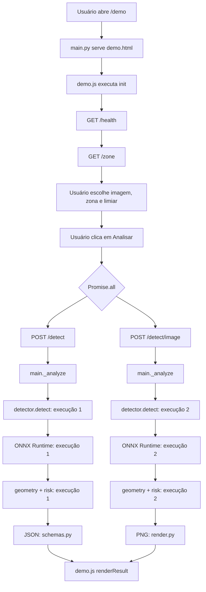

# Pipeline de chamadas da aplicação

Este diretório contém o núcleo da aplicação **Edge Risk Zone**. O objetivo deste documento é mostrar, de forma didática e na ordem real de execução, como a interface, a API, o detector, a geometria, a regra de risco e a renderização se chamam.

> Os arquivos Python deste diretório são módulos da aplicação, não programas independentes. O ponto de entrada é `app.main:app`, carregado pelo Uvicorn.

## Visão rápida



Os dois ramos de análise são requisições diferentes. Portanto, `_analyze()` e `PersonDetector.detect()` são executados **duas vezes** para cada clique em **Analisar**: uma vez para gerar o JSON e outra para gerar o PNG.

## Responsabilidade de cada arquivo

| Arquivo | Responsabilidade | Chamado principalmente por |
|---|---|---|
| [`main.py`](./main.py) | Cria a API, inicializa o serviço, valida as requisições e coordena os demais módulos | Uvicorn e navegador |
| [`config.py`](./config.py) | Lê as configurações das variáveis de ambiente | `main.lifespan()` |
| [`schemas.py`](./schemas.py) | Define e valida os contratos Pydantic da zona e das respostas JSON | `main.py` |
| [`detector.py`](./detector.py) | Pré-processa a imagem, executa o YOLOX no ONNX Runtime e pós-processa as detecções | `main._analyze()` |
| [`geometry.py`](./geometry.py) | Valida o polígono, converte coordenadas e calcula inclusão e distância | `schemas.py` e `risk.py` |
| [`risk.py`](./risk.py) | Classifica cada pessoa e calcula o risco geral da cena | `main._analyze()` |
| [`render.py`](./render.py) | Desenha zona, margem, caixas e rótulos e codifica o PNG | `main.detect_image()` |
| [`static/demo.js`](./static/demo.js) | Controla a interface, chama a API e apresenta os resultados | Navegador |

## 1. Inicialização do serviço

No container, o comando final do [`Dockerfile`](../Dockerfile) é equivalente a:

```bash
python -m uvicorn app.main:app --host 0.0.0.0 --port 8000
```

A sequência exata é:

```text
Uvicorn
└─ importa app.main:app
   └─ main.lifespan(app)
      ├─ config.get_settings()
      │  └─ Settings lê MODEL_PATH, ZONE_PATH, INPUT_SIZE, CONF_THRESHOLD,
      │     NMS_IOU, ORT_INTRA_THREADS, MAX_CONCURRENT_INFERENCES,
      │     MAX_UPLOAD_MB e MAX_IMAGE_PIXELS
      ├─ detector.PersonDetector(...)
      │  ├─ onnxruntime.InferenceSession(..., CPUExecutionProvider)
      │  ├─ confere o tamanho fixo da entrada do modelo
      │  ├─ cria o semáforo de concorrência
      │  └─ detector.build_grids(INPUT_SIZE)
      ├─ define Image.MAX_IMAGE_PIXELS
      ├─ main.load_zone(ZONE_PATH)
      │  └─ schemas.ZoneConfig(...)
      │     └─ geometry.validate_polygon_norm(...)
      ├─ detector.detect(imagem RGB vazia)
      │  └─ inferência de aquecimento
      └─ yield: o serviço começa a aceitar requisições
```

O modelo ONNX, a zona padrão e as grades do YOLOX são carregados uma única vez e guardados em `app.state`. Se o modelo ou a zona forem inválidos, a inicialização falha antes de o serviço aceitar requisições.

### Inferência de aquecimento

O aquecimento usa uma imagem RGB vazia com `INPUT_SIZE × INPUT_SIZE` e chama o mesmo `PersonDetector.detect()` usado nas requisições. Isso prepara alocações e caches para reduzir o custo da primeira análise real.

## 2. Abertura da demonstração

Ao abrir `http://localhost:8000/demo`, ocorre:

```text
Navegador
└─ GET /demo
   └─ main.demo()
      └─ main._static_page("demo.html")
         └─ navegador carrega demo.css e demo.js
            └─ demo.js:init()
               ├─ GET /health
               │  └─ main.health()
               └─ GET /zone
                  └─ main.default_zone()
```

`init()` consulta `/health` primeiro e, depois de receber a resposta, consulta `/zone`. Se `/zone` falhar, a interface usa `FALLBACK_ZONE`, definido no próprio JavaScript.

Quando o usuário escolhe uma imagem, `demo.js:loadImage()` cria uma URL `blob:` e desenha uma prévia local no `canvas`. **A imagem ainda não é enviada à API nessa etapa.** Ajustes no limiar ou na zona também são apenas locais até o clique em **Analisar**.

## 3. Clique em “Analisar”

A função `analyze()` de [`demo.js`](./static/demo.js) executa esta ordem:

1. Confirma que existe um arquivo selecionado.
2. Valida o limiar: deve ser maior que `0` e menor que `1`.
3. Valida o JSON da zona.
4. Captura uma chave com arquivo, limiar e zona para controlar se o resultado ficará desatualizado.
5. Cria um `FormData` separado para cada requisição, com os campos `file`, `zone` e `conf`.
6. Inicia, com `Promise.all`, duas chamadas HTTP em paralelo:
   - `POST /detect`, que devolverá JSON;
   - `POST /detect/image`, que devolverá PNG.
7. Aguarda as duas respostas. Se qualquer uma falhar, o resultado não é desenhado.
8. Converte a primeira resposta em objeto JSON e a segunda em `Blob`.
9. Chama `renderResult()` para atualizar faixa de risco, contagens, imagem, tabela, tempos, JSON e histórico.
10. Compara a chave capturada com os controles atuais e marca o resultado como atualizado ou desatualizado.

### Duas requisições significam duas inferências

O navegador não chama `/detect` e reaproveita seu resultado para criar o PNG. Cada endpoint chama `_analyze()` separadamente:

```text
POST /detect                         POST /detect/image
└─ main.detect()                     └─ main.detect_image()
   └─ main._analyze()                   └─ main._analyze()
      └─ detector.detect()                 └─ detector.detect()
```

As chamadas HTTP são iniciadas em paralelo. Entretanto, `PersonDetector` protege `onnxruntime.session.run()` com um `BoundedSemaphore`. Com o valor padrão `MAX_CONCURRENT_INFERENCES=1`, apenas uma inferência ONNX roda por vez; a outra espera uma vaga. Essa espera é contabilizada em `preprocess_ms`, pois o cronômetro de inferência começa somente depois que o semáforo é adquirido.

## 4. Pipeline comum de cada `POST`

Tanto `/detect` quanto `/detect/image` passam individualmente pelo fluxo abaixo.

### 4.1 Limite do corpo HTTP

Antes do endpoint, o middleware `main.limit_body_size()` verifica o cabeçalho `Content-Length`:

```text
requisição HTTP
└─ limit_body_size()
   ├─ corpo declarado acima de MAX_UPLOAD_MB + 64 KiB → HTTP 413
   └─ dentro do limite → próximo estágio
```

Os `64 KiB` adicionais são uma folga para a estrutura do `multipart/form-data`; o arquivo em si continua limitado a `MAX_UPLOAD_MB`.

### 4.2 Entrada e validação

O endpoint chama:

```python
a = _analyze(request, file, zone, conf)
```

Dentro de `_analyze()`, a ordem é:

```text
main._analyze()
├─ valida conf
├─ main._read_image(upload, settings)
│  ├─ lê no máximo MAX_UPLOAD_BYTES + 1
│  ├─ recusa arquivo vazio ou grande demais
│  ├─ Pillow lê o cabeçalho e verifica a quantidade de pixels
│  ├─ ImageOps.exif_transpose() corrige a orientação da câmera
│  └─ converte a imagem para RGB
├─ main._parse_zone(zone_raw, default_zone)
│  └─ schemas.ZoneConfig(...)
│     └─ geometry.validate_polygon_norm(...)
├─ escolhe conf informado ou CONF_THRESHOLD
└─ chama detector.detect(image, effective_conf)
```

A zona precisa ter pelo menos três vértices, coordenadas normalizadas entre `0` e `1` e área não nula. A margem deve estar entre `0` e `0,5`.

### 4.3 Detecção de pessoas

`PersonDetector.detect()` divide o processamento em três etapas cronometradas.

#### A. Pré-processamento

```text
detector.detect()
└─ detector.letterbox(image, INPUT_SIZE)
   ├─ preserva a proporção da imagem
   ├─ redimensiona com interpolação bilinear
   ├─ completa o quadro com cinza 114
   └─ converte RGB → BGR
      └─ transpose HWC → CHW
         └─ adiciona dimensão de lote: NCHW float32
```

Os pixels permanecem no intervalo `0–255`, conforme esperado pelo modelo usado.

#### B. Inferência ONNX

```text
adquire uma vaga no BoundedSemaphore
└─ session.run(None, {input_name: blob})
   └─ YOLOX-Tiny no CPUExecutionProvider
```

Para entrada `416 × 416`, a saída contém `3.549` candidatos, formados pelas grades `52 × 52`, `26 × 26` e `13 × 13`, com strides `8`, `16` e `32`.

#### C. Pós-processamento

```text
saída bruta do modelo
└─ detector.decode_person_boxes()
   ├─ decodifica centro, largura e altura de cada caixa
   ├─ calcula score = objectness × probabilidade da classe person
   └─ remove candidatos abaixo do limiar
      └─ detector.nms()
         └─ elimina caixas duplicadas por IoU
            └─ detector.scale_and_clip()
               ├─ volta para a escala da imagem original
               ├─ limita coordenadas às bordas da imagem
               └─ descarta caixas sem área útil
```

O retorno é um `DetectionResult` com uma lista de `Detection` e os tempos de pré-processamento, inferência e pós-processamento.

## 5. Geometria e classificação de risco

Depois da detecção, `_analyze()` continua nesta ordem:

```text
DetectionResult
├─ geometry.to_pixels(zone.polygon, largura, altura)
├─ risk.margin_in_pixels(zone.margin, largura, altura)
├─ para cada Detection:
│  └─ risk.classify_person()
│     ├─ Detection.foot_point
│     │  └─ centro da base da caixa
│     └─ geometry.distance_to_zone()
│        ├─ geometry.point_in_polygon()
│        └─ geometry.distance_point_segment() para cada aresta
└─ risk.overall_level(risks)
```

A regra aplicada a cada pessoa é:

| Condição do centro da base da caixa | Nível |
|---|---|
| Dentro do polígono; distância `0` | `red` |
| Fora, mas com distância menor ou igual à margem | `yellow` |
| Fora e além da margem | `green` |

A margem em pixels é `margin × diagonal da imagem`. O risco geral é o pior nível encontrado; se nenhuma pessoa for detectada, é `green`.

`_analyze()` reúne imagem, detecções, riscos, nível geral, zona, polígono em pixels, margem e limiar em um objeto `Analysis`.

## 6. Separação das duas saídas

Somente depois do pipeline comum os endpoints seguem caminhos diferentes.

### `POST /detect`: resposta JSON

```text
main.detect()
└─ Analysis
   ├─ cria um schemas.PersonOut por pessoa
   ├─ conta green, yellow e red
   ├─ cria Alert e Summary
   ├─ cria Metadata e TimingsOut
   └─ devolve schemas.DetectResponse
      └─ FastAPI valida e serializa o JSON
```

A resposta contém risco geral, alerta, contagens, caixas, confiança, ponto do pé, distância da zona, nível individual, parâmetros usados e tempos.

### `POST /detect/image`: resposta PNG

```text
main.detect_image()
└─ render.render_annotated_png()
   ├─ converte a imagem para RGBA
   ├─ desenha a faixa amarela da margem
   ├─ preenche a zona em vermelho
   ├─ desenha caixa, ponto do pé e rótulo de cada pessoa
   ├─ desenha o banner do risco geral
   └─ codifica PNG com compress_level=1
      └─ Response(image/png)
```

Além do PNG, a resposta traz os cabeçalhos `X-Risk-Level`, `X-Persons` e `X-Inference-Ms`.

## 7. Apresentação no navegador

Após as duas respostas terem sucesso, `demo.js:renderResult()`:

1. Mostra o risco geral e a mensagem do alerta.
2. Preenche as contagens por nível.
3. Revoga a URL `blob:` do PNG anterior e cria uma para o novo PNG.
4. Monta a tabela de pessoas usando `createElement()` e `textContent`.
5. Mostra os tempos retornados por `/detect`.
6. Exibe o JSON formatado.
7. Adiciona um resumo textual ao histórico local, limitado a seis itens.

Se o usuário mudar o arquivo, o limiar ou a zona enquanto as respostas estão em trânsito, o resultado recebido ainda é exibido, mas o selo o marca como **desatualizado**.

## 8. Rotas auxiliares

| Rota | Função em `main.py` | Fluxo |
|---|---|---|
| `GET /health` | `health()` | Lê modelo, tamanho de entrada, providers e versão do detector em `app.state` |
| `GET /zone` | `default_zone()` | Devolve o `ZoneConfig` carregado na inicialização |
| `GET /demo` | `demo()` | Serve `static/demo.html` |
| `GET /demo/ajuda` | `demo_help()` | Serve `static/ajuda.html` |
| `GET /demo/pipeline` | `demo_pipeline()` | Serve `static/pipeline.html` |
| `/static/*` | `StaticFiles` | Serve JavaScript, CSS e demais arquivos estáticos |
| `/docs` | FastAPI | Documentação Swagger gerada a partir das rotas e dos schemas |

## 9. Códigos de erro esperados

| Código | Origem típica |
|---:|---|
| `400` | Arquivo vazio ou conteúdo que não é uma imagem válida |
| `413` | Corpo, arquivo ou resolução acima do limite configurado |
| `422` | Arquivo obrigatório ausente, `conf` fora do intervalo ou zona inválida |

## Resumo em uma linha

```text
demo.js → main.py → detector.py/ONNX → geometry.py → risk.py → schemas.py (JSON) ou render.py (PNG) → demo.js
```
